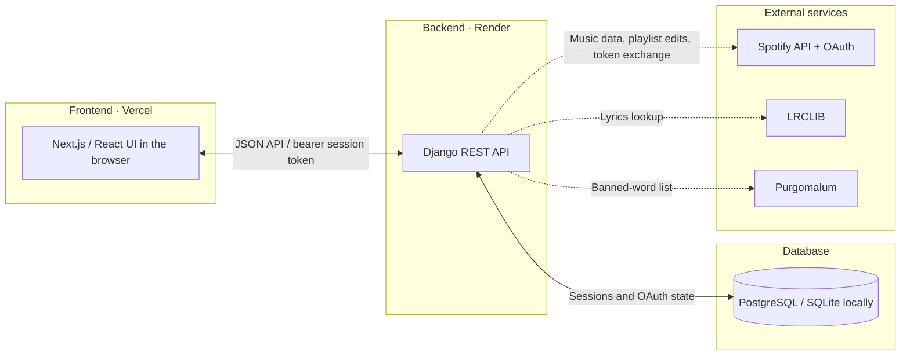

# Spotify Tools

A full-stack application providing Spotify Playlist management and analytics tools that are not available natively in Spotify. 

This project is a successor to [SpotifyTools CLI](https://github.com/Rohpat419/SpotifyTools-CLI). 

**[Live App](https://spotify-tools-xi.vercel.app/)**


## Project Status and the Death of SpotifyTools

SpotifyTools began as a hobby project built around the Spotify Web API and was designed for anyone with a Spotify account. 

In 2026, Spotify significantly restricted access to its Web API for individual developers. Only five authorized users can use the entire suite of this app's features, a new user would require me to un-register an existing user. 

This SpotifyTools app predates these restrictions and currently retains Extended Quota access. Even with this, the application can only be fully functional to 5 registered users which I would manually add to an authorized users list in the Spotify Developers console. 

Because of this, SpotifyTools is effectively feature-complete but shelved. This repo can be cloned or forked, and with some setup, a developer can run this on their local or deploy their own version of the app, register themselves in the Spotify Developer's console, and use the app in its full capacity. 

For more information: 
- [Spotify Development Mode changes](http://developer.spotify.com/blog/2026-02-06-update-on-developer-access-and-platform-security)
- [Spotify quota modes](https://developer.spotify.com/documentation/web-api/concepts/quota-modes)

## Features

### Duplicate Detection
Find duplicate songs in a Spotify playlist using track metadata rather than just the Spotify Track IDs. 

Duplicates are detected based on the following criteria: 
- Track title 
- Artist(s)
- Duration (within a few seconds margin)

Any detected duplicates can be removed directly from the playlist. 

### Explicit Content Filtering
Scans a playlist for explicit content, using either Spotify metadata (fast option) or a scan of each song's lyrics. The lyric scan is slower but more accurate than Spotify metadata. See Katy Perry's Hot N Cold as an example of a song with explicit lyrics that is NOT marked as explicit by Spotify metadata. 

You can then choose to remove tracks from the existing playlist or create a new, clean version of the playlist. 

### Listening Analytics

View your top Spotify tracks and artists over: 
- Last month
- Last 6 months
- Long-term listening history

### Playlist Creation Tool

Utility for building Spotify playlists from your Liked Songs. I find building playlists from my Liked Songs to be wayyyyy too many clicks. 

## Architecture



The frontend runs in the user's browser and calls Django directly. During sign-in, Django redirects the browser to Spotify for authorization using PKCE, handles the callback, and returns the user to the frontend with a single-use login code. The frontend exchanges that code for a session token; Spotify credentials remain on the backend.

## Tech Stack

### Frontend
- Next.js
- React
- TypeScript
- Tailwind CSS
- Deployed on Vercel [Live App](https://spotify-tools-xi.vercel.app/)

### Backend
- Python
- Django REST Framework
- PostgreSQL
- Gunicorn
- Hosted on Render [Ping](https://spotify-tools-eozl.onrender.com/api/debug/ping)

### Integrations
- Spotify Web API
- LRCLIB (lyrics retrieval for explicit content check)
- Purgomalum (for retrieving list of profane words)

## Running Locally

### Prerequisites
- Python 3.11 or 3.12
- Node.js 22 with npm
- Spotify Developer status and access to the Spotify Developer Console. [Start here](https://developer.spotify.com/)

Clone the repository (all platforms):

```powershell
git clone https://github.com/Rohpat419/SpotifyTools.git
cd SpotifyTools
```

### Running Backend Locally

From the repository root, create a Python virtual environment and activate it:

**Windows PowerShell**

```powershell
python -m venv .venv
.\.venv\Scripts\Activate.ps1
```

If PowerShell blocks activation, skip it and use the explicit virtual-environment Python commands below. If `python` is not on your PATH, use the path to your installed Python executable for the first command.

**macOS / Linux (bash or zsh)**

```bash
python3 -m venv .venv
source .venv/bin/activate
```

Use a Python version listed in the prerequisites. If Linux reports that `venv` or `ensurepip` is unavailable, install your distribution's venv package for that Python version before retrying.

#### Install dependencies:

**Windows PowerShell**

```powershell
.\.venv\Scripts\python.exe -m pip install -r backend/requirements.txt
```

**macOS / Linux**

```bash
./.venv/bin/python -m pip install -r backend/requirements.txt
```

Create `.env` in the repository root, alongside this README. Replace the example client credentials with those from your Spotify Developer application:

```dotenv
SPOTIFY_CLIENT_ID=your-spotify-client-id
SPOTIFY_CLIENT_SECRET=your-spotify-client-secret
SPOTIFY_REDIRECT_URI=http://127.0.0.1:8000/api/auth/callback
FRONTEND_SUCCESS_URL=http://127.0.0.1:3000/auth/success
SPOTIFY_SCOPES=playlist-modify-private playlist-read-private user-top-read user-library-read
CORS_ALLOWED_ORIGINS=http://127.0.0.1:3000
ALLOWED_HOSTS=127.0.0.1,localhost
SECRET_KEY=paste-your-generated-key-here
```

After installing the backend dependencies, generate a Django secret key from the repository root:

**Windows PowerShell**

```powershell
.\.venv\Scripts\python.exe -c "from django.core.management.utils import get_random_secret_key; print(get_random_secret_key())"
```

**macOS / Linux**

```bash
./.venv/bin/python -c "from django.core.management.utils import get_random_secret_key; print(get_random_secret_key())"
```

Copy the output into `.env` as `SECRET_KEY='your-generated-key'`, keeping the single quotes. Generate it once per environment and keep it stable between restarts. For production, generate a different key and set it in the backend host's environment settings without the surrounding quotes.

Keep `.env` and generated keys out of Git. Leave `DATABASE_URL` unset  to use SQLite.

In your Spotify Developer application's settings, add and save this exact redirect URI:

```text
http://127.0.0.1:8000/api/auth/callback
```

The scheme must be `http`, matching the local Django server. Keep your production redirect URIs registered as well.

Initialize the local database and start Django from the repository root:

**Windows PowerShell**

```powershell
.\.venv\Scripts\python.exe backend/manage.py migrate
.\.venv\Scripts\python.exe backend/manage.py runserver 127.0.0.1:8000
```

**macOS / Linux**

```bash
./.venv/bin/python backend/manage.py migrate
./.venv/bin/python backend/manage.py runserver 127.0.0.1:8000
```

SQLite is used locally when there is no configured external database. 

### Running Frontend Locally

Open another terminal at the repository root:

The frontend commands below use `npm.cmd` for Windows PowerShell (avoids the need to run the command to allow scripts in terminal: `Set-ExecutionPolicy -Scope Process -ExecutionPolicy Bypass`). 

On macOS/Linux, use `npm` instead; the remaining arguments and configuration are the same.

```powershell
cd frontend
npm.cmd ci
```

Create `frontend/.env.local` with this line so the frontend calls your local backend:

```dotenv
NEXT_PUBLIC_API_BASE_URL=http://127.0.0.1:8000
```

Start the development server from `frontend/`:

```powershell
npm.cmd run dev -- --hostname 127.0.0.1
```

Open [http://127.0.0.1:3000](http://127.0.0.1:3000) and connect Spotify. Use `127.0.0.1` consistently rather than switching to `localhost`. Spotify Developer Dashboard may not accept `localhost` as a redirect URI. 

Restart the relevant server after changing environment variables. If you change `SPOTIFY_SCOPES`, disconnect and reconnect Spotify to grant the new permissions; `user-library-read` is required for Playlist Builder's Liked Songs access.

## Current Limitations

- **Duplicate matching is approximate.** Tracks are compared using normalized titles, artists, and duration, not audio. Different recordings can be grouped together, and metadata differences can hide duplicates. Review the selected copies before removing them.
- **Playlist edits are not atomic and have no built-in undo.** Duplicate removal supports up to 100 selected copies per operation. Retained copies of an identical Spotify track ID may need to be reinserted, resetting their added dates. A failure midway through a multi-request edit can leave partial changes; inspect the playlist before retrying.
- **Explicit filtering cannot guarantee clean content.** Missing lyrics from LRCLIB fall back to Spotify's explicit flag. Word matching uses English letters and apostrophes, without understanding context, phrases, or other languages reliably.
- **Large lyrics scans can time out.** Lyrics are fetched sequentially, while the frontend stops waiting after 30 seconds. There is no background job or resumable scan, and downstream rate limits or outages can interrupt requests.
- **Playlist Builder only filters loaded Liked Songs.** The Spotify API returns Liked Songs in pages of 50, and the app only loads more songs if the user clicks "Load More". The filters that are used to search these songs only apply to the loaded subset, not the entire library. The user must load all Liked Songs to filter them completely.
- **Choosing a destination playlist in Playlist Builder is limited to the user's first 50 playlists.** The Spotify API returns playlists in pages of 50, and the app only loads the first page. The user must create a new playlist if their desired destination is not in the first 50. Designing for more than 50 playlists felt like a bit much. 
- **Listening analytics are limited to top items.** The UI displays five tracks or artists for each supported time range; it does not provide a full listening-history export or play counts.

## Hosting
- **Frontend:** Hosted on Vercel → [Live App](https://spotify-tools-xi.vercel.app/). Built using [v0](https://v0.app/chat). 
- **Backend:** Hosted on Render → [Health Check](https://spotify-tools-jo2u.onrender.com/api/debug/ping). Built with the help of [GPT-5](https://chat.openai.com/) and [Claude](https://claude.ai).

## Future Steps

With the 5-user cap from the Spotify Web API, most of these are aspirational, these are things I'd build if Spotify ever reopens the door.

### UX Improvements

Give users the option to input their own "banned words" list to extend the functionality of the explicit content filter.

Light / dark mode toggle for the frontend. Every developer's favorite feature.

Fetching a user's playlists and letting them choose which one to filter for explicit content or find duplicates in. Right now, the user has to input the playlist ID manually. This would display playlists on the frontend, then they would choose the playlist and what tool to apply. 

### New Features

Incorporate more user analytics beyond Top N — this would require users to upload their extended streaming history export from Spotify, since the API doesn't provide it.

Build an email notification system to alert users when followed artists release new music. Spotify’s own system is biased toward popular artists so people may not get updates from an artist they listen to unless that artist is popular.

## Challenges and Lessons Learned: 
**Spotify API Updates:** As mentioned earlier, the Spotify API being updated to only allow up to 5 users that I manually register to use the app is a major limitation that has effectively killed the app. A dev-lesson here is that dependency on a third-party can go wrong on a whim. In this case, the entire project depended on Spotify so this was unavoiable but a lesson learned nonetheless for industry projects. 

**Spotify OAuth:** The Spotify OAuth flow is a pain. On both the Backend and Frontend. Dealing with the success page on the frontend and the OAuth flow on the Backend was challenging. AI did not do the best here and it took multiple shots and debugging sessions to get this right (more on this later).

**Lack of staging server:** Without a staging server, testing the code was difficult and caused a lot of code pushes to show me failure logs on the 'Production' Vercel/Render instead of the failures showing up on a local env. This was a bad idea for a project that kept getting iterated on. Having a staging server to see how my code would act in prod without waiting for a deploy would be faster and more aligned with industry practices.

**AI thoughts (and more OAuth):** AI is really good with code that is readily available on the internet, but can struggle with the finer details. This came up while deploying the backend to render, and getting the Spotify OAuth flow working just right. 
- Render issues: AI did not know how to structure the render.yaml to fit my project needs. From having the backend in the backend folder (GPT-5 really wanted everything in the repo root) to environment variable management on render.com to trying to set up Postgres. GPT-5 was fairly unhelpful here. 
- OAuth issues: The Spotify OAuth flow has been a thorn in my side ever since this project's first iteration a few years ago. From the redirect uri to the enforced success page, there were difficulties everywhere. Testing the POC was difficult, getting things right was difficult because of how strict Spotify is (like 127.0.0.1 is ok as a local redirect url but not localhost, which was confusing).
- More OAuth issues: Converting to prod was also difficult since now there needed to be a redirect to a page on the deployed frontend.
- All the while, AI (GPT-5) didn't know the fixes for what I was dealing with since the Spotify error messages could mean many different errors (for example: "Invalid URL" being returned after signing in to Spotify, the redirect URL could be wrong OR the redirect URL could be un-registered in the Spotify developer dashboard). It comes down to training data and the Spotify OAuth flow specifically is fairly niche so it makes sense that GPT-5 struggled with it due to a lack of examples in its training data.

**Spotify's February 2026 Dev Mode Changes (more complaints):** Just when the app was in the best shape it had ever been — proper per-user auth, new features, cleaner UX — Spotify pulled the rug out. The irony of spending a weekend building multi-user support only to learn the platform now caps you at 5 users is not lost on me. Sometimes you build the right thing at the wrong time.

**Logging:** Logging is a developer's best friend. I think the less logging I had when dealing with an OAuth issue, the longer it took to debug. Adding more logging statements and try/except blocks were extremely important in debugging the errors. Otherwise, the errors were ridiculously opaque. 
